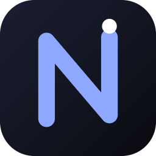

# Nerd

Превращает телефон или планшет на Android в графический планшет для компьютера на Windows. Рисуйте пальцем или стилусом прямо в Krita, Photoshop и других программах: на экране устройства видна картинка с монитора, её можно увеличивать, двигать и вращать.

## Как это работает

- **Компьютер.** Программа `Nerd.exe` живёт в трее, создаёт в Windows виртуальное перо (Windows Ink) и по Wi-Fi отдаёт на устройство картинку монитора.
- **Устройство.** Приложение Nerd показывает экран компьютера, а касания и стилус отправляет обратно как перо или мышь.
- Всё работает по локальной сети, без интернета и облака.

## Что умеет

- Рисование пальцем или стилусом (давление и наклон стилуса передаются в программы рисования).
- Режим «Мышь»: курсор, клик и правый клик долгим нажатием.
- Увеличение и сдвиг двумя пальцами, вид показывает именно ту область экрана, где вы рисуете.
- Вращение холста двумя пальцами, отмена тремя пальцами, возврат четырьмя.
- Быстрые клавиши: отмена, возврат, размер кисти, ластик, Ctrl, Shift, пробел.
- Выбор монитора, поиск компьютера в сети без ввода IP.
- Подтверждение подключения на компьютере кнопкой «Разрешить», запоминание устройств.

## Установка

Скачайте файлы из последнего релиза:

1. **Windows 10 (1809) и новее:** распакуйте `Nerd-windows-x64.zip` и запустите `Nerd.exe`. Значок «N» появится в трее. При первом запуске Windows спросит доступ к сети: разрешите для частной сети. Программа не подписана, поэтому SmartScreen может показать предупреждение (кнопка «Подробнее», затем «Выполнить в любом случае»).
2. **Android 8.0 и новее:** установите `Nerd-android.apk` (разрешите установку из неизвестных источников).
3. Подключите устройство и компьютер к одной Wi-Fi сети, откройте приложение Nerd: компьютер найдётся сам.
4. На компьютере появится окно «Разрешить подключение?». Нажмите «Разрешить». Дальше устройство подключается само.

Меню по щелчку на значке в трее: выбор монитора, запуск вместе с Windows, «Забыть все устройства», выход.

## Подсказки

- Если в Krita нет давления, в настройках планшета (Settings, Configure Krita, Tablet Settings) выберите Windows Ink.
- Порты: UDP 47800 (перо и мышь), TCP 47801 (экран), UDP 47802 (поиск). Журнал программы лежит в `%APPDATA%\Nerd\nerd.log`.
- Для лучшей отзывчивости используйте Wi-Fi 5 ГГц.

## Безопасность

Подключение возможно только после подтверждения на компьютере. Для каждого разрешённого устройства хранится секретный ключ, управление принимается только от текущей сессии. Рисовать и нажимать клавиши можно только после «Разрешить».

## Сборка из исходников

- **Windows-программа** (`pc/`): Rust (MSVC) и Windows SDK, затем `cargo build --release`, результат `pc/target/release/Nerd.exe`.
- **Android-приложение** (`android/`): JDK 17 и Android SDK 35, затем `gradlew assembleDebug`. Для релизной сборки нужен свой ключ подписи, путь к его настройкам задаётся переменной `NERD_KEYSTORE_PROPS`.
